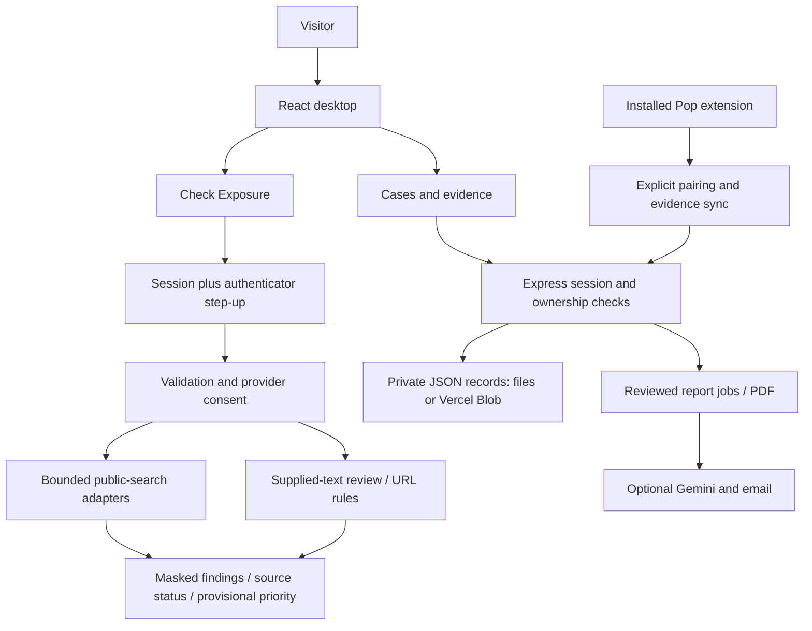

# StrikeOut — DevFest readiness

Audit started **November 2, 2026**; updated **November 3, 2026**. Exhibition target: **November 28, 2026**.
Baseline: upstream `main` at `dd0806bc628ce40a2f86c347e1ced52562dcd57f`.
PR #11 was merged into `main` at `ff15c0c`; the fictional demo is public.
PRs #12 and #13 are merged into `main`; local follow-up work is in progress.

**Release decision: not yet exhibition-ready.** Local readiness checks pass, but
that does not establish a complete, offline, accessible exhibition experience or
operational production integrations. This is an engineering audit, not a penetration
test or certification. Findings below distinguish observed behavior from hypotheses.

## 1. Current architecture and primary experience

**Verified:** React 19 / TypeScript TSX, Vite 7, Tailwind 4, Express 5 / Node
(package declares >=22; this audit ran on Node 26.7.0). Website and API share an
origin. `server.mjs` uses Vite middleware locally and built assets in production;
`vercel.json` routes production requests to the Express function or static assets.
There is no relational database or migration system. `api/store.mjs` stores JSON
records in ignored `.data/` locally or private Vercel Blob in production, with
conditional updates. `extension/` is an independent Chromium/Firefox extension.
`OSINT BACKEND/` preserves a second backend; the website uses `api/osint/`.

**Verified product today:** incident recovery and evidence management, plus a
separate public-exposure assessment. **Inferred intended focus for DevFest:** help
people understand and reduce their own public digital exposure. Preserve recovery
and Pop; do not represent the whole application as an autonomous web crawler.

## 2. Feature inventory

| Capability | Evidence / current state | Label |
|---|---|---|
| Accounts, isolated workspaces, consented case/evidence saves | Existing API tests pass; scrypt passwords and HTTP-only session cookie | Verified |
| TOTP setup, recovery codes, sign-in, exposure step-up | Existing MFA tests pass; AES-GCM encrypted secrets, replay protection, timed grant | Verified |
| Production TOTP across devices / Google sign-in | Requires configured production services and a consenting operator; not exercised in this audit | Not Yet Tested |
| Supplied-document text/PDF review | Text review implemented; PDF extraction in browser, no OCR; pattern matches are not proof | Verified |
| Password breach-prefix check | Five-character hash-prefix design exists; live provider reachability separate | Verified (implementation) |
| Public references | GitHub issues/PRs, optional Brave and Google/Bing/DuckDuckGo through SerpApi; exact snippet matches, bounded results | Verified (implementation) |
| Email breach membership | HIBP adapter exists; requires separate key | Verified (implementation), live Not Yet Tested |
| Scoped Google templates | `site:` plus exact identifier and selected filters, scoped result validation, manual handoff | Verified (implementation) |
| Reverse image lookup | SerpApi Lens adapter and manual Google handoff; no identity/location inference | Verified (implementation), live Not Yet Tested |
| Result prioritization and link flags | Severity/evidence sorting, deduplication, local URL signals; no threat-feed reputation lookup | Verified |
| Private Instagram / phone target ownership | Exposure auth service keeps these searches locked pending ownership evidence | Verified; incomplete integration |
| Instagram follow service | Operator-only local browser workflow; no private-post import, no Vercel browser worker | Verified (implementation), live Not Yet Tested |
| Recovery complaint / report / PDF | Deterministic local report, optional AI jobs and reviewed email delivery; tests pass | Verified |
| Pop extension | Separate source, packages, pairing, evidence library, local warnings and screenshot tools | Verified (implementation); installed-browser journey Not Yet Tested |
| OSINT Framework inventory | Catalog data and license exist, explicitly not 1,171 integrations | Verified |
| Dedicated offline exposure exhibition | No standalone offline exposure journey found at baseline | Verified missing |
| Visitor interest form / exhibition QR page | No dedicated DevFest assets found at baseline | Verified missing |

## 3. Bugs, debt, security and reliability

| Priority | Finding and implication | Label |
|---|---|---|
| P0 | No dedicated offline exposure demo; live MFA and search depend on backend/provider availability | Verified |
| P0 | Consent is a declaration, not proof of ownership for every email/domain/LinkedIn/name search. MFA proves account access only. Keep demo synthetic; production needs an explicit supported authorization model | Verified |
| P0 | Live exposure/advanced/link frontend fetches have no client deadline; a stalled request can leave a busy state indefinitely | Verified |
| P0 | Several public providers can be tried sequentially. Individual timeouts do not guarantee total request fits the Vercel function budget | Inferred; load/timeout testing pending |
| P0 | Existing desktop browser script expects pre-MFA headings and old extension package links; unit-test success does not verify current desktop journey | Verified by script inspection; browser run pending |
| P0 | Provider keys present/configured flags are not health checks; full production service availability must be tested before booth use | Verified |
| P1 | Rate limiting uses a process-local Map and forwarded headers. It is not a durable distributed limit across serverless instances | Verified |
| P1 | Session/challenge expiry is checked, but no general expiry sweep or documented retention schedule was found; account deletion does not enumerate all historical sessions/receipts | Verified by inspected paths; full retention inventory pending |
| P1 | Two backend copies, duplicated static bridge assets, multiple extension ZIP versions, long App/Recovery components increase maintenance and drift risk | Verified; do not delete until compatibility checked |
| P1 | Dependency ranges include `latest`; lockfile makes current install reproducible but later updates need review | Verified |
| P1 | No project lint or TypeScript type-check scripts/config; Vite transpilation is not a type check | Verified |
| P1 | Main JS build is 858.16 kB / 256.98 kB gzip, PDF worker 1,264.34 kB. Lazy loading warrants measurement | Verified sizes; user impact Inferred |
| P1 | Docs contain historical counts/version statements; current package links and capabilities need reconciliation | Verified |
| P1 | Public results mask credential/numeric patterns but may retain emails/names and identifying URLs. Do not show live personal results on a booth screen | Verified |
| P1 | Full keyboard, screen-reader, contrast and small-screen audits remain outstanding | Not Yet Tested |
| P2 | New providers, large database migration, broad analytics and architectural rewrites | Deferred deliberately |

Existing safeguards to preserve: same-origin write checks; per-owner storage access;
private Blob access; hashed sessions; recent sign-in for MFA enrollment; conditional
MFA writes; explicit provider consent; bounded queries; output redaction; HTTPS and
public-address validation for image URLs; timeouts/size caps in search adapters;
React text escaping; safe error messages; no-store headers; reviewed, idempotent email
attempts. **Verified by code/tests**, not an assertion of comprehensive security.

Current tracked-text scan found **no matches** for a limited set of private-key,
Google API key, GitHub token and Stripe live-key patterns. **Verified limited scan**;
not a guarantee that arbitrary keys, history, screenshots or ignored files are clean.
Secrets remain in private environment files; never print or copy their values.

## 4. UI/UX assessment

**Verified in local browser:** existing Windows 98 desktop, Pop, case workspace,
Check Exposure entry, and authenticator gate render. Exposure assessment is behind
MFA, with explanation of what it does and does not establish. The existing visual
identity is distinctive and must be retained. **Inferred:** desktop metaphors and
multiple tools obscure the exposure value proposition for a first-time visitor.
An explicit, small exhibition entry is preferable to replacing the desktop.

Improve plain-language introduction, source coverage, severity vs confidence,
remediation, network errors and progress. Keep unverified sources visibly separate
from completed checks. Do not add fabricated progress bars or "safe" verdicts.

## 5. Baseline verification (November 2)

- **Verified:** root `npm test`: **124 passed, 0 failed** after granting loopback
  access. Initial restricted run failed because test servers could not listen
  (`EPERM`), not because 16 product features were proven broken.
- **Verified:** `npm run build` passed, 57 modules. Node emitted a deprecation warning.
- **Verified:** `npm audit --json`: **0 reported vulnerabilities** in the root
  lockfile at this point in time. This does not cover application logic or guarantee
  absence of undisclosed vulnerabilities.
- **Not Yet Tested:** separate backend suite, current live provider smoke checks,
  production sign-in, mobile layout, offline exhibition, accessibility, load testing.
- No lint/type-check claim: these commands are absent.
- Logs are local `/tmp/devfest-baseline-unrestricted-tests.log`,
  `/tmp/devfest-baseline-build.log`, `/tmp/devfest-dependency-audit-network.json`.

## 6. Ranked backlog and implementation order

### P0 — exhibition gates

1. Complete and record baseline checks, integrations, route/storage inventory.
2. Build a clearly labeled synthetic exposure demo, independent of accounts,
   external APIs and internet. Fixed examples, disclosed source coverage, masked
   findings, severity/confidence, recommendations, empty/incomplete outcomes,
   reset and privacy-conscious export. Local offline server and booth entry.
3. Bound frontend exposure requests and show readable network/provider errors.
4. Test actual desktop and dedicated demo journeys, reset, small screen, keyboard,
   API failures, authorization and no-network operation. Fix observed failures.
5. Verify deployment configuration, target authorization policy and operator
   rehearsal. Do not claim a live integration is ready without a real check.

### P1 — useful before freeze

1. Type/lint baseline, dependency reproducibility, dedicated CI checks.
2. Document retention and implement appropriate expiry/deletion maintenance.
3. Durable quota limiting and performance measurements under expected booth load.
4. Results export polish, accessibility and UI refinement within existing brand.
5. Booth overview, QR entry, contact option, demo scripts and onboarding.

### P2 — after DevFest

Additional provider integrations, major storage migration, advanced analytics,
large UI rewrite, automatic retrieval expansion. No credential hunting, camera
discovery, people tracking, mass harvesting or private-account bypass.

## 7. Schedule and definition of done

| Dates | Deliverable |
|---|---|
| Nov 3–7 | Audit findings triaged, baseline and P0 failures reproducible |
| Nov 8–14 | Exposure and synthetic demo journeys complete |
| Nov 15–20 | UI clarity, mobile and supported integration checks |
| Nov 21–24 | Security review, offline/device QA, screenshots and scripts |
| Nov 25–27 | Feature freeze, critical fixes only, deployment and booth rehearsal |
| Nov 28 | Exhibition using frozen tested release and offline fallback |

Exhibition **done** means a new visitor can understand the purpose, start the
synthetic demo without keys/login/internet, review clearly fictional masked
findings and source coverage, understand uncertainty, choose practical privacy
steps, export a labeled summary and reset for the next visitor. No personal
identifiers persist between visitors. Live mode remains gated and unavailable
services are honestly reported. All automated checks pass; the booth laptop and
at least one phone-size viewport pass manual testing. A frozen commit, offline
startup instructions, architecture explanation, support checklist and rehearsed
30-second/90-second/3-minute scripts are available.

MU20 ₹35,000 achievement and recognition from Uplife / Sonali Guha are
**user-supplied claims, not independently verified in this audit**. No partner logos,
endorsement language or relationship claims will be published without evidence and
permission. Exhibition date/location are planning inputs supplied by the team.

## 8. Implementation log and release blockers

Audit document was created before feature edits. The detailed actual checks and
screenshots are in [the November 3 QA record](docs/DEVFEST-QA-2026-11-03.md).

| Batch | Files changed | Functionality / observed result | Remaining limit / next task |
|---|---|---|---|
| Audit | `DEVFEST_READINESS.md` | Architecture, feature inventory, verified/inferred/untested findings and P0/P1/P2 backlog | Deeper production and security validation pending |
| Synthetic demo | `frontend/public/devfest*`, `scripts/serve-demo.mjs`, `tests/devfest-demo.test.mjs`, `ExposureApp.tsx` | Four fictional cases, source coverage, masked findings, recommendations, consent, copyable/downloadable JSON and reset. Local and public browser journeys verified after PR #11 merged | Actual booth-device offline rehearsal pending |
| Reliability / results | `shared/http-client.js`, `api/osint/request-budget.mjs`, `api/osint/recommendations.mjs`, three exposure components, related tests | 20/100-second client deadlines, shared 80-second provider budget, failure messages, source status and next steps. Local protected assessment returned masked results | Distributed rate limits remain |
| Performance / checks | `document-text.ts` lazy load, `tsconfig.json`, package metadata/lock, `scripts/check-syntax.mjs`, `.github/workflows/readiness.yml`, updated desktop script | Initial JS bundle 858.16→424.76 kB. 137 tests, syntax, `tsc`, build pass locally; current dependency advisory scan found zero known advisories. PR #11 checks passed on Node 22 and 24 | Updated desktop browser script not yet run |
| Booth kit | `scripts/package-demo.mjs`, `scripts/devfest-qr.mjs`, `docs/DEVFEST-*`, `CONTRIBUTING.md`, README | Copied package checksum/server verified; QR matrix decoded; public destination opens in browser; scripts, architecture, privacy, troubleshooting and screenshots ready | Scan QR with a separate physical phone and test actual booth laptop offline |
| Release follow-up | `scripts/check-deployment.mjs`, `api/index.mjs`, `api/rate-limit.mjs`, `.github/ISSUE_TEMPLATE/devfest-feedback.yml`, related tests | PR #12 merged; public revision `6770565e9572`, private durable storage and four demo assets verified; GitHub feedback form opens; 142 tests passed before the ownership follow-up | Distributed quota, production live-account MFA/provider QA, phone accessibility and real booth rehearsal pending |
| Ownership follow-up | `api/osint/authenticator-auth.mjs`, `api/index.mjs`, exposure components and related tests | Only the account's exact verified email can be searched. Instagram, phone, LinkedIn, identity-card, domain, image and legacy GitHub-profile searches are locked until matching target-proof flows exist. Local document review and password-prefix checks remain available after MFA. 143 tests pass locally | Domain/profile/image verification flows and production email-verification availability need implementation and validation |
| Retention and visitor QA follow-up | `scripts/cleanup-expired.mjs`, `tests/cleanup-expired.test.mjs`, package script, mobile CSS, browser scripts and docs | Dry-run cleanup inventories only expired auth artifacts, with a 24-hour grace period and conditional cloud deletion; local preview counted 248 scanned, 34 eligible, 0 deleted. Public deployment checker confirmed revision `71e66413f65e`. Full check passed 147 tests, syntax, typecheck and build. Desktop browser journey passed after a stale selector was fixed. MFA, ownership gate, masked results, export and 390px mobile layout passed 25 browser checks; small-screen exposure text was enlarged | Production cleanup not scheduled or run; complete keyboard/screen-reader QA and physical-device rehearsal still pending |

The live provider smoke check completed for GitHub, Pwned Passwords prefix,
SerpApi Google and Bing. SerpApi DuckDuckGo returned HTTP 502. Other optional
providers were not configured locally. No production integration result is
implied by these local checks.

**Current release blockers:** build target-proof flows before unlocking profile,
domain and image searches; test a fresh production MFA sign-in, verified-email
ownership and supported providers with
an authorized operator account; run a full keyboard/screen-reader and phone-sized
full-app pass; implement distributed rate limiting and schedule production retention cleanup;
scan the QR with a separate phone; rehearse on the real booth laptop without
external internet. The public fictional page works, but the whole product has
not earned a production-ready claim.
